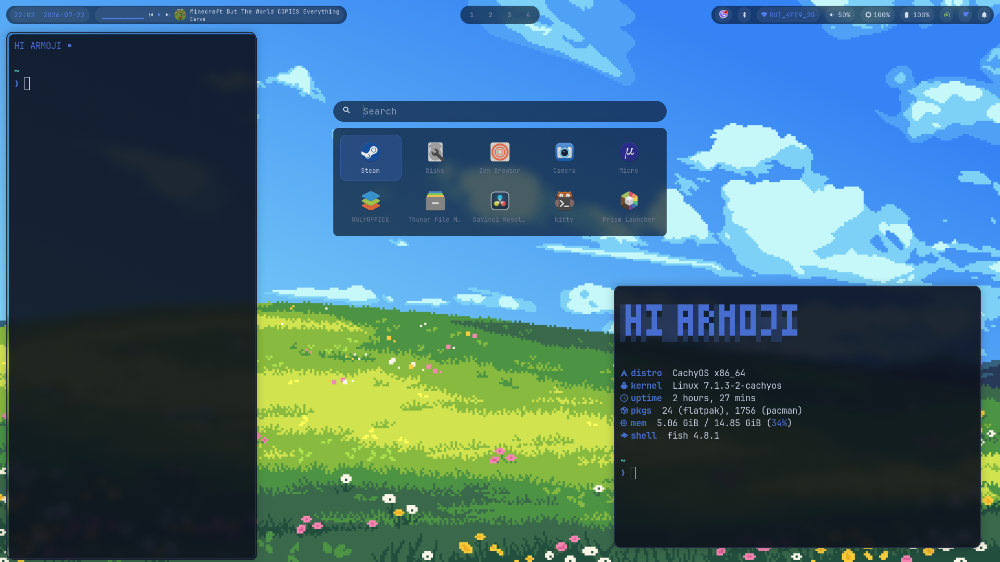

# armojidots



My SwayFX dotfiles — built from scratch, one step at a time.

> Status: **daily-drivable** — the whole desktop shell (bar, dock, Spotlight
> launcher, volume/brightness OSD, terminal sidebars) runs as **one Quickshell
> process** with animations everywhere; switchable **style packs** (incl. a
> Nothing OS 5 frosted-glass look) on top of a palette engine; lock screen +
> idle; GTK theming.

> [!WARNING]
> This is mostly **vibecoded** and tailored specifically to my own machine,
> workflow, and taste — it's **not meant to be used as-is by other people**.
> Feel free to dig through it for ideas or steal a piece (Spotlight, the
> dock, the sidebars, etc.) for your own setup, but don't expect it to work by
> just cloning and stowing on a different system.

## What's here

| Package | What it configures |
|---------|--------------------|
| `sway/` | SwayFX window manager + scripts (theme engine, OSD trigger, mirroring, watchers) |
| `shell/` | The desktop shell — bar, dock, OSD, Spotlight and the sidebars in one Quickshell process (`qs -c armoji-shell`) |
| `styles/` | Style packs: `default` (glass pills) and `nothingos` (Nothing OS 5: frosted glass, Geist, dot-matrix accents) |
| `kitty/` | Main terminal (`Win+T`); font/opacity come from the style pack |
| `foot/` | Second terminal (colors generated by the theme engine) |
| `swaync/` | Notifications + control center (glass, theme-driven) |
| `swaylock/` | Lock screen (config generated by the theme engine) |
| `swayidle/` | Idle policy (lock / screen off / lock before sleep) |
| `fish/` | Shell config + HI ARMOJI fastfetch greeting |
| `fastfetch/` | Fetch config with custom ASCII logo |
| `starship/` | Prompt |
| `gtk/` | GTK 3/4 settings (adw-gtk3-dark) |
| `cursor/`, `environment-d/` | Bibata-Modern-Classic cursor (Xcursor + session env) |
| `icons/` | Custom icons for the sidebar terminals |
| `systemd/` | User services — elephant (Spotlight's search backend) |
| `assets/` | Slot-Multicolor-Dark-Icons (not packaged anywhere — bundled + installed by script) |
| `waybar/` | Previous top bar — fallback only; its scripts (`media.sh`, `lang.sh`, `power-profile.sh`, `bluelight.sh`) are still used by the shell's bar |
| `spotlight/`, `dock/`, `osd/` | Previous GTK4/Python launcher, dock and OSD — fallbacks only (their systemd units are disabled) |
| `walker/`, `nwg-dock/` | Older launcher/dock — walker is only started by the theme/wallpaper dmenu pickers |

## Setup

- **OS:** CachyOS (Arch)
- **WM:** [SwayFX](https://github.com/wlrfx/swayfx) (`swayfx-git` — window open/close, move/resize and workspace-switch animations)
- **Shell:** [Quickshell](https://quickshell.org) (QML)
- **Terminal:** kitty (foot also themed)

## Install

```sh
sudo pacman -S wlroots0.20 foot kitty stow brightnessctl pavucontrol swaybg \
       nemo swaync swayidle autotiling grim slurp wl-clipboard jq cava \
       playerctl wireplumber quickshell qmltermwidget
# fallback apps only: waybar python-gobject gtk4 gtk4-layer-shell
yay -S swayfx-git swaysome swaylock-effects elephant-desktopapplications \
       elephant-calc elephant-runner elephant-websearch elephant-menus walker-bin \
       bluetuith-bin bibata-cursor-theme ttf-geist ttf-geist-mono
# nothingos pack's dot-matrix accent: Bitcount Grid Single (Google Fonts) → ~/.local/share/fonts
git clone https://github.com/Armoji-code/armojidots.git ~/dotfiles
cd ~/dotfiles
stow sway shell styles waybar systemd walker kitty foot swaync swaylock \
     swayidle fish fastfetch starship gtk cursor environment-d icons
elephant service enable
mkdir -p ~/Pictures/Wallpapers   # drop wallpapers here for /set wallpaper
./assets/install-icon-theme.sh  # extracts Slot-Multicolor-Dark-Icons to ~/.local/share/icons

# sidebar terminal colors: the terminal widget only reads schemes from its own dir
sudo ln -s ~/.config/armoji-shell/terminal.colorscheme \
     /usr/lib/qt6/qml/QMLTermWidget/color-schemes/armoji.colorscheme
# CachyOS's ananicy-cpp classes every `qs` as a background service (nice 10) —
# give the shell normal UI priority (the dir must sort before 00-default)
sudo mkdir -p /etc/ananicy.d/00-armoji
echo '{ "name": "qs", "nice": -6 }' | sudo tee /etc/ananicy.d/00-armoji/armoji.rules
~/.config/sway/scripts/theme.sh style default   # writes all generated colors/tokens once
```

Configs are symlinked into `~/.config` by [GNU Stow](https://www.gnu.org/software/stow/) — editing the live config edits the repo.

## Keybinds

| Keys | Action |
|------|--------|
| `Win+D` | Toggle Spotlight |
| `Win+T` | Terminal (kitty) |
| `Win+E` | File manager (Nemo) |
| `Win+W` | Browser (zen-browser) |
| `Win+Q` | Close window |
| `Win+Space` | Toggle floating |
| `Win+F` | Toggle fullscreen |
| `Win` + left-drag / right-drag | Move / resize window |
| `Win+Arrows` / `Win+Shift+Arrows` | Move / resize window |
| `Win+1…0` | Switch workspace (per-monitor, via [swaysome](https://gitlab.com/hyask/swaysome)) |
| `Win+Shift+1…0` | Move window to workspace and follow |
| `Win+Alt+1…0` | Move the whole workspace to slot N and follow |
| `Win+R` | Toggle the terminal sidebar (fish) |
| `Win+Shift+R` | Toggle the Claude Code sidebar |
| `Win+Shift+H` / `M` / `V` | Sidebar: other edge / sides↔top-bottom / cycle size |
| `Win+Shift+S` | Region screenshot → clipboard + notification |
| `Win+Ctrl+S` | Full-screen screenshot → clipboard (silent) |
| `Win+N` | Toggle notification center (swaync) |
| `Win+L` | Lock screen |
| Volume / Mute keys | `wpctl` (±5%, capped 100%) — the OSD pops up; works on the lock screen |
| Mic-Mute key | `wpctl` mic toggle |
| Brightness keys | `brightnessctl` ±5% — the OSD pops up |
| Play/Pause · Next · Prev · Stop | `playerctl` |

## The shell (`shell/`, Quickshell)

One process, `qs -c armoji-shell`, started from `autostart.conf`. Everything
is QML in `shell/.config/quickshell/armoji-shell/`; colors and shape tokens
come from `~/.config/armoji-shell/{colors,style}.json`, written by
`theme.sh` and picked up live (no restart). It reloads itself when its files
change — which also ends the sidebar sessions.

### Bar
Clock + media pill · workspaces · status. Each group's padding is even on all
sides and its corners follow its end chips (concentric radii). Workspace
buttons grow/shrink as workspaces appear and vanish, with a highlight that
slides between them; chip widths ease when their text changes; hover
tooltips (calendar on the clock, battery time, etc.). The **media pill**
(visible only while a player exists) has rounded **cava** bars,
prev/play-pause/next, round cover art (click to cycle players) and
title/artist. Status: tray, Bluetooth, network, keyboard layout (EN/LT),
volume, brightness (live via backlight uevents), battery, power profile,
auto-lock toggle, blue-light filter, notification bell.

### Spotlight (`Win+D`)
**elephant** is the search backend (fuzzy apps + usage ranking + calc); the
shell owns the UI: a **5×2 grid of top apps** when empty, a **results list**
as you type, with open/close and resize animations.
`qs -c armoji-shell ipc call spotlight search "<text>"` opens it pre-filled.

| Command | Does |
|---------|------|
| `/set` | Menu: **Style**, **Colors**, **Tone**, **Wallpaper**, **Wi-Fi**, **Bluetooth**, **Monitors** |
| `/set style` | Switch style pack (restyles the whole desktop) |
| `/set color` | Pick a palette (a style pack may limit the choice) |
| `/set wallpaper` | Thumbnails of `~/Pictures/Wallpapers`; pick one to apply it |
| `/power` | Lock / Logout / Suspend / Reboot / Shutdown |
| `/update` | Full system / pacman / AUR update, **dotfiles** (`git pull` of this repo), kernel manager |
| `/web <query>` | Web search in the browser |
| `/keys` | Keybind cheat-sheet |
| `23*7` | Inline math — Enter copies the result |

### Dock
Autohide dock of running windows: a 3px strip at the bottom edge reveals it
(slide + fade), it hides 1s after you leave. Windows are grouped per
workspace into sub-pills, sidebars after a divider; macOS-style eased
magnification; click focuses the window (jumps to its workspace).

### OSD
Volume/brightness pill above fullscreen apps. It reacts to the level itself
changing (PipeWire sink, backlight uevents), so it also shows for changes made
elsewhere (pulsemixer, apps); `scripts/osd.sh` only performs the change.

### Sidebars (`Win+R`, `Win+Shift+R`)
Terminals (fish / `claude`) in **QMLTermWidget** glass panels that slide in
from their edge and glide between edges/sizes. Hidden, never killed: the
session lives until its program exits. Both share one layer window that is
1×1 px while hidden (a full-screen transparent layer costs SwayFX blur every
frame). Keyboard: exclusive while a sidebar is open or under the pointer,
back to your windows once the pointer leaves (SwayFX drops focus from
on-demand layers on every re-arrange). The widget paints its background
opaque, so the scheme uses pure black and `shaders/unblack.frag` turns it into
transparency (rebuild the `.qsb` with `qsb` from qt6-shadertools).

## Theming

Two independent axes, both in `sway/scripts/theme.sh`:

- **Palette** — `/set color`: **wallpaper** (extracted from the current
  wallpaper, follows wallpaper changes), ruby, orange, dandelion, emerald,
  cobalt, bubblegum, purpur, b&w. One seed derives a color family written to
  the shell, kitty/foot (full ANSI palette), sway borders, swaync, swaylock,
  GTK 3/4 apps and the sidebar terminal scheme. `/set tone` (light / heavy /
  loud) sets how hard it sits on everything.
- **Style pack** — `/set style`: `styles/.config/armoji-styles/<pack>/`
  holds the shape/spacing/font tokens per app (`shell.json`, `swaync.css`,
  `kitty.conf`, `foot.ini`, `sway.conf`, …) and a `pack.conf`
  (`allowed_palettes`, `neutral`, `lucent` = frosted glass, `ui_font` /
  `mono_font` / `lock_font` — the GTK app fonts follow the pack and revert to
  Adwaita for packs without them).

**Icons:** [Slot-Multicolor-Dark-Icons](assets/) system-wide (the shell pins
it with `//@ pragma IconTheme`). Only the generic folder icon is recolored to
the accent; branded folders keep their look. **Cursor:**
Bibata-Modern-Classic everywhere.

## Lock & idle

`Win+L` locks (swaylock-effects: blurred wallpaper, big clock, palette ring,
font from the style pack). Idle policy (`swayidle/config`): 5 min → lock,
10 min → screen off, lock before sleep. The bar's auto-lock chip (󰅶 / 󰒲)
holds a Wayland idle inhibitor — **on by default** (󰅶 = staying awake); click
to arm (󰒲) and the idle timers apply.

## Config structure

```
sway/.config/sway/
├── config            # entry point: variables + includes
├── input.conf        # touchpad/mouse
├── keybinds.conf     # apps, window controls, Spotlight, sidebars, screenshots
├── media-keys.conf   # volume / brightness (→ osd.sh) / playback keys (--locked)
├── workspaces.conf   # swaysome per-monitor workspaces
├── appearance.conf   # borders + gaps (+ generated colors.conf)
├── effects.conf      # SwayFX effects (+ generated style-effects.conf from the pack)
├── animations.conf   # animation_duration_ms (swayfx-git)
├── rules.conf        # window rules (floating glass TUIs, …)
├── autostart.conf    # qs, swaync, swayidle, swaybg, autotiling, watchers, elephant
└── scripts/          # theme.sh, osd.sh, wallpaper-pick, mirror, monitors, watchers,
                      # sidebar.sh / sidebar-control.sh (old kitty sidebars, fallback)

shell/.config/quickshell/armoji-shell/
├── shell.qml                     # root: Bar, Osd, Dock, Spotlight, Sidebar
├── Theme.qml                     # colors.json + style.json (live)
├── Bar.qml  Group.qml  Chip.qml  Tip.qml  TipHost.qml
├── Clock  Media  Workspaces  Tray  Network  Bluetooth  Volume  Backlight
│   Battery  IdleInhibit  Notifications  ScriptChip  Brightness (.qml)
├── Dock.qml  Osd.qml
├── Spotlight.qml  Commands.js    # launcher UI + /commands
├── Sidebar.qml  SidebarPanel.qml
└── shaders/unblack.frag(.qsb)

styles/.config/armoji-styles/<pack>/   # pack.conf + per-app tokens
```
