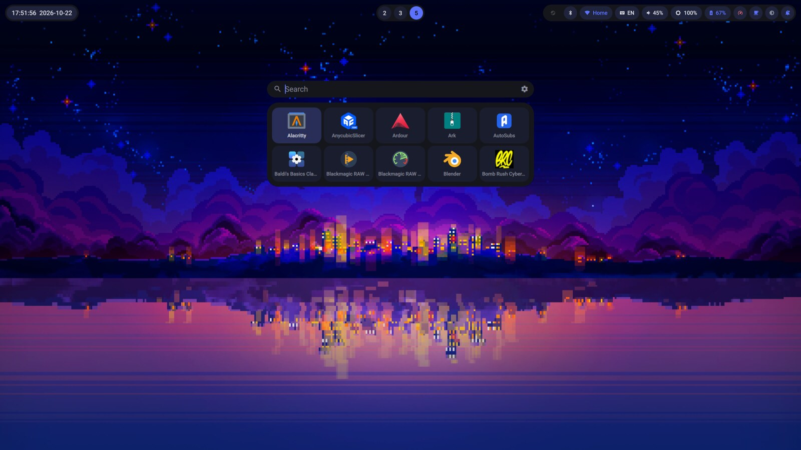
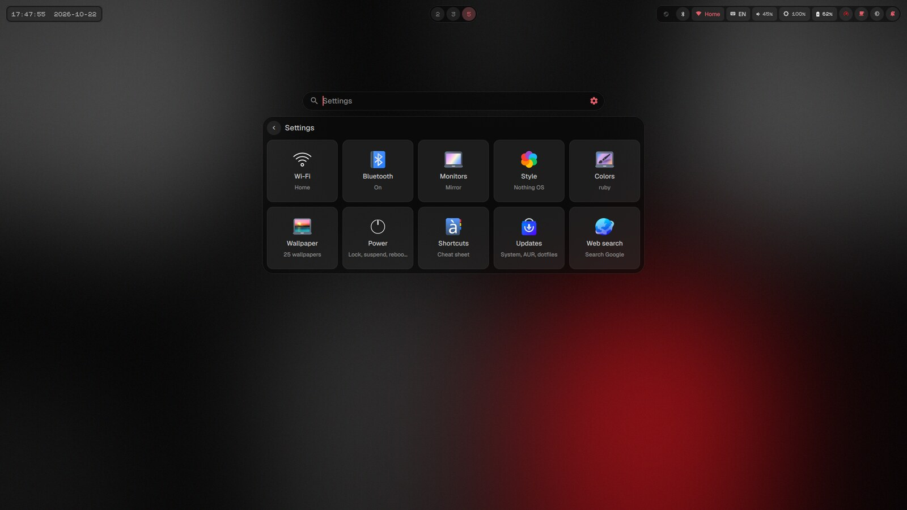
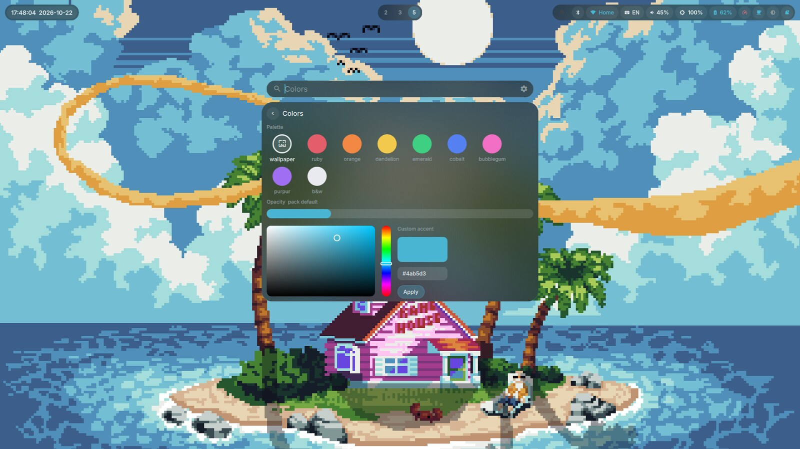
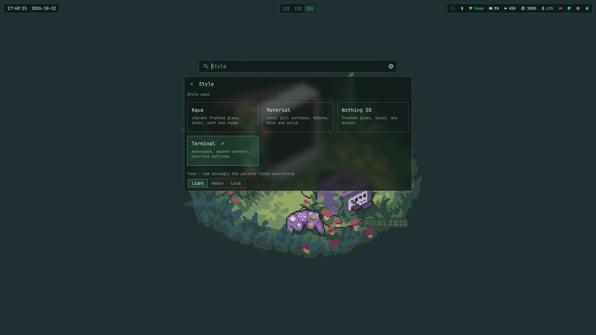
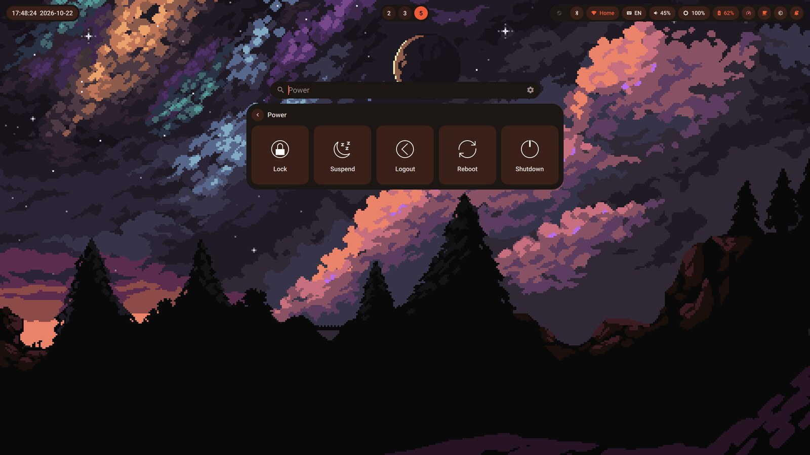
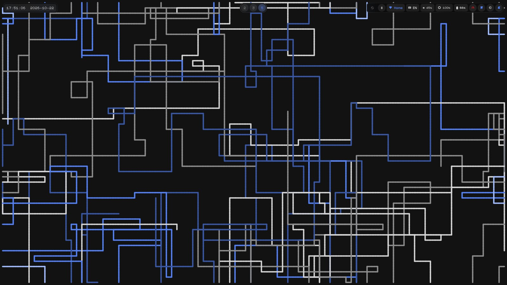
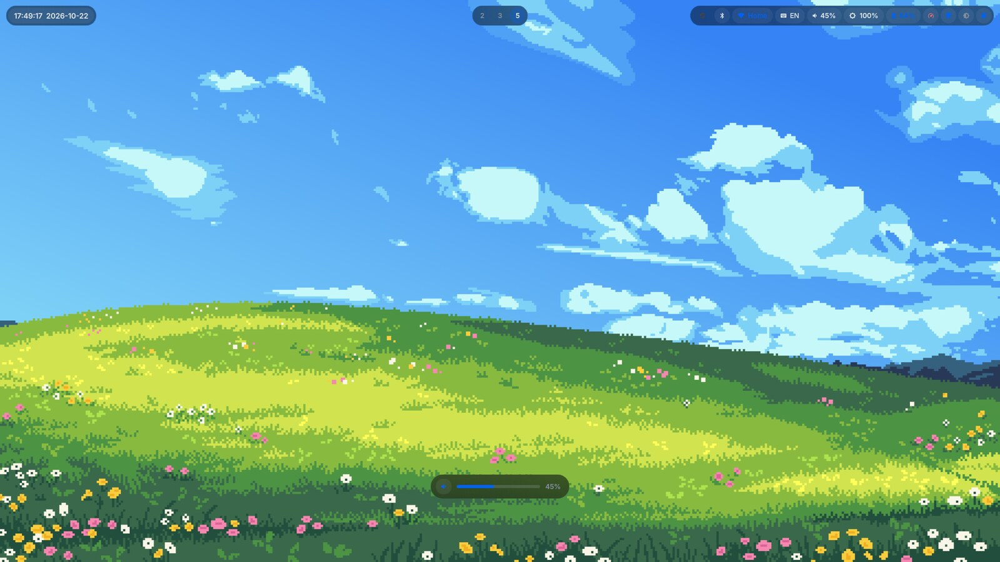
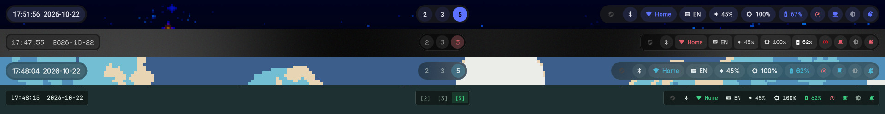

# armojidots

A complete [SwayFX](https://github.com/wlrfx/swayfx) desktop: bar, dock,
launcher, settings, OSD, notifications, lock screen and terminal sidebars, all built as one
[Quickshell](https://quickshell.org) process. Switchable style packs and color
palettes restyle everything at once: the shell, terminals, GTK apps and
the lock screen.



| | |
|---|---|
|  |  |
| **Nothing OS** · settings hub | **Aqua** · palette + custom color picker |
|  |  |
| **Terminal** · style packs and tone | **Material** · power menu, colors taken from the wallpaper |
|  |  |
| **Pipes** screensaver in the theme colors | Volume / brightness **OSD** |



## Features

- **One shell process:** bar, dock, OSD, launcher, notifications and sidebars in QML, animated
  throughout, and reloaded live when the theme changes.
- **Spotlight (`Win+D`):** app grid, fuzzy search, inline math, and a settings
  hub for Wi-Fi, Bluetooth, monitors, customization (style, colors, wallpaper,
  fonts, cursor, icons), idle, power, updates
  and shortcuts, all usable by mouse or keyboard.
- **Style packs:** Material (default), Nothing OS, Aqua and Terminal. Each one
  defines shapes, spacing, fonts and translucency through tokens.
- **Palettes:** take the accent from the wallpaper, pick a preset, or choose
  any color. Set the tone (light / heavy / loud) and the surface opacity.
- **Screensaver:** a pipes.sh-style animation in the current palette after 2 minutes idle.
- **Terminal sidebars:** fish (`Win+R`) or Claude Code (`Win+Shift+R`) in a
  glass panel that slides in from any screen edge.
- **Laptop-aware:** display mirroring or extending, power profiles that follow
  the charger (performance when plugged in, balanced on battery, power saver at
  20% or below; manual changes stick until the next change), and low-battery
  warnings.
- **Themed everywhere:** kitty, fish + starship, notifications, the lock screen, GTK
  3/4 and the icon folders.

## Requirements

- An Arch-based distro (Arch, CachyOS, EndeavourOS, …).
- A display manager that lists Wayland sessions (SDDM, GDM, greetd, …).
- An AUR helper (yay or paru). The installer can set up yay for you.

## Install

```sh
git clone https://github.com/Armoji-code/armojidots.git ~/dotfiles
cd ~/dotfiles
./install.sh
```

The installer:

1. installs only the packages the desktop uses (`--needed`, nothing is
   reinstalled);
2. moves any existing config it would replace to
   `~/.local/state/armojidots/backup-<date>/`;
3. links the configs into `~/.config` with [GNU Stow](https://www.gnu.org/software/stow/);
4. asks for your **name** (shown in the terminal greeting) and your **keyboard
   layouts**;
5. installs the icon theme (no wallpapers are bundled; add your own to
   `~/Pictures/Wallpapers`);
6. optionally applies two small system tweaks (sudo): the sidebar terminal
   color scheme, and normal CPU priority for the shell under `ananicy-cpp`.

Then log out and choose **SwayFX** in your display manager.

```sh
./install.sh --name        # change the greeting name later
./install.sh --uninstall   # unlink everything and restore your old configs
```

Uninstalling removes the links and everything the installer added, then
restores the backed-up files. Packages are kept; the uninstaller lists them so
you can remove the ones you don't need.

## Keybinds

| Keys | Action |
|------|--------|
| `Win+D` | Spotlight |
| `Win+T` | Terminal (kitty) |
| `Win+E` | File manager (Nemo) |
| `Win+W` | Default web browser |
| `Win+Q` | Close window |
| `Win+Space` | Toggle floating |
| `Win+F` | Toggle fullscreen |
| `Win` + left / right drag | Move / resize window |
| `Win+Arrows` / `Win+Shift+Arrows` | Move / resize window |
| `Win+1…0` | Workspace (per monitor, via [swaysome](https://gitlab.com/hyask/swaysome)) |
| `Win+Shift+1…0` | Move window to workspace and follow |
| `Win+Alt+1…0` | Move the whole workspace to slot N |
| `Win+R` / `Win+Shift+R` | Terminal / Claude Code sidebar |
| `Win+Shift+H` / `M` / `V` | Sidebar: other edge / sides ↔ top-bottom / cycle size |
| `Win+Shift+S` / `Win+Ctrl+S` | Region / full screenshot to the clipboard |
| `Win+N` | Notification center |
| `Win+L` | Lock |
| `Shift+Alt` | Next keyboard layout |
| Media, volume and brightness keys | Work as expected, with the OSD (also on the lock screen) |

## Spotlight commands

Type `/` (or click ⚙) for the settings hub, or jump straight to a page. Short
prefixes work (`/po` opens Power). Text after a command is a quick action, and
the header shows what Enter will do.

| Command | Page |
|---------|------|
| `/settings` | Hub with live status for every page |
| `/wifi` | Networks; connect, disconnect, forget, password |
| `/bluetooth` | Devices; pair, connect, trust, forget, battery |
| `/monitors` | Mirror / extend, drag to arrange, resolution, refresh, scale, rotation (10 s keep-or-revert) |
| `/customize` | Style, colors, wallpaper, fonts, cursor and icons, one tab each |
| `/style` · `/tone` | Customize › Style: style packs and tone |
| `/colors` | Customize › Colors: palettes, custom color picker, opacity |
| `/wallpaper` | Customize › Wallpaper: images from `~/Pictures/Wallpapers` |
| `/fonts` · `/cursor` · `/icons` | Customize › Fonts (interface, monospace, display), cursor theme and size, icon theme and folder color |
| `/idle` | Screensaver, auto-lock and screen-off, each on/off with a delay |
| `/power` | Lock, suspend, logout, reboot, shutdown |
| `/update` | System / AUR / Flatpak / dotfiles updates in a terminal inside the box, or in the background with a notification when done |
| `/keys` | Keybind cheat sheet |
| `/audio` | Output / input device, volume per app (up to 150%) |
| `23*7` | Inline math; Enter copies the result |

## Customization

- **Style and colors:** use Spotlight (`/style`, `/colors`), or
  `~/.config/sway/scripts/theme.sh style <pack>` and `theme.sh apply <palette|#hex>`.
- **Fonts, cursors, icons:** drop fonts, cursor themes or icon themes into
  `~/Themes/Fonts`, `~/Themes/Cursors` or `~/Themes/Icons`; every app can use
  them, and they show up in Customize. Font choices reset to the style's own
  when you switch style.
- **Wallpapers:** put images in `~/Pictures/Wallpapers` and pick them with
  `/wallpaper`. The `wallpaper` palette follows the current image. The
  wallpapers in the screenshots belong to their artists and aren't included.
- **Your own tweaks:** fish aliases and environment go in
  `~/.config/fish/conf.d/local.fish`, keyboard layouts in
  `~/.config/sway/keyboard.conf`, and monitor layouts in
  `~/.config/sway/outputs`. These files are not tracked, so they survive updates.
- **New style packs:** copy a folder in `styles/.config/armoji-styles/`.
  `pack.conf` sets fonts, palette limits and translucency (`neutral`, `lucent`,
  `alpha_*`), and `shell.json` holds every size, radius and color token of the
  shell. Colors can be `name@alpha`, for example `"accent@0.14"`.

Updating is `/update` → Dotfiles (`git pull`). Thanks to the symlinks, the
shell picks up the changes by itself.

## Structure

| Package | What it configures |
|---------|--------------------|
| `shell/` | The Quickshell desktop shell (`qs -c armoji-shell`) |
| `sway/` | SwayFX config and scripts: theme engine, OSD, mirroring, battery and activation watchers |
| `styles/` | Style packs |
| `kitty/` | Terminal |
| `fish/`, `starship/`, `fastfetch/` | Shell, prompt and greeting |
| `swayidle/` | Idle policy (lock before sleep) |
| `gtk/`, `cursor/`, `environment-d/`, `icons/` | GTK settings, cursor, session environment, sidebar icons |
| `waybar/` | Helper scripts used by the bar (layout, media, power profile, blue-light) |
| `elephant/` | App search backend config (Spotlight) |
| `assets/` | Icon theme archive and screenshots |

Generated files (colors, style tokens, the greeting logo)
are written by `theme.sh` / `install.sh` and are not tracked.

## Credits

- [SwayFX](https://github.com/wlrfx/swayfx), [Quickshell](https://quickshell.org),
  [elephant](https://github.com/abenz1267/elephant)
- [Slot-Multicolor-Dark-Icons](https://github.com/L4ki/Slot-Plasma-Themes) by L4ki (bundled, GPL-3.0), Bibata cursor
- Fonts: Inter, Roboto, Geist, JetBrains Mono Nerd Font, Bitcount Grid Single

## License

[MIT](LICENSE). The bundled icon theme keeps its own license (GPL-3.0, see
[`assets/LICENSE-Slot-Icons`](assets/LICENSE-Slot-Icons)).
